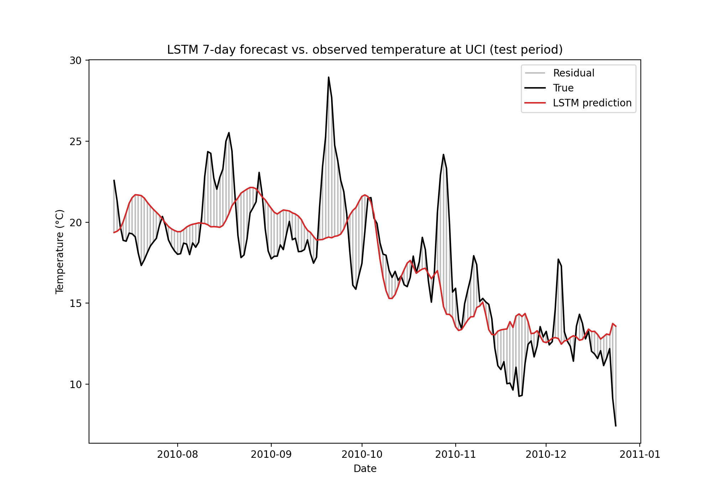
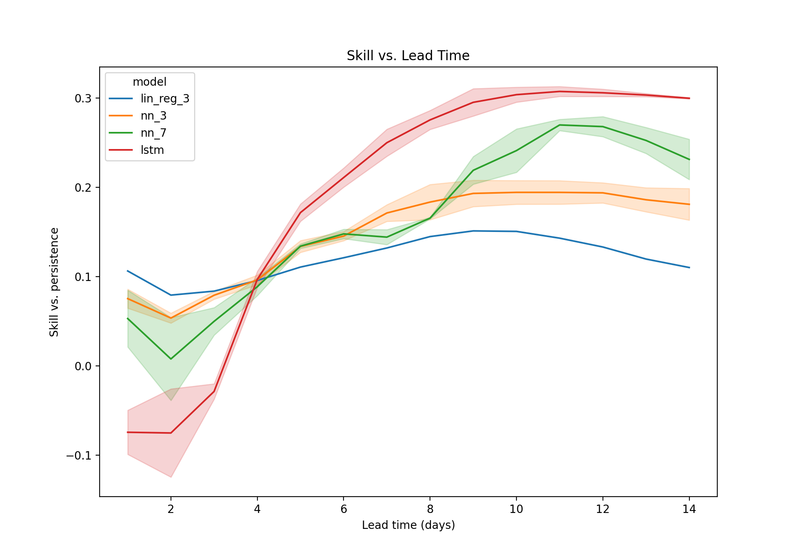

# Temperature Prediction with Machine Learning

**Video:** [Project summary](https://drive.google.com/file/d/1Xjs32SnCbuBnyoeKw7zn0jACH_a5BUJy/view?usp=sharing)

## The Question

How accurately can machine learning predict the daily mean temperature at UC Irvine one week in advance with only local data, and how does model complexity affect accuracy?

The data used are from ERA5 reanalysis daily means of 2 m temperature, 10 m wind (u and v components), mean sea level pressure, and total precipitation over the continental US for 2009–2010 with calculated 3 and 7 day precipitation averages. The models use the grid cell nearest UC Irvine (33.75° N, 117.75° W). Each model predicts the temperature 7 days ahead and is compared against persistence, a baseline that predicts the temperature in 7 days will equal today's. Skill is $1 - \text{RMSE}_{\text{model}} / \text{RMSE}_{\text{persistence}}$, so 0 means no better than persistence and 1 means a perfect forecast.

The data is split by time: 2009 for training, January–June 2010 for validation (early stopping), and July–December 2010 for testing. Rows are dropped at the start of the validation and test sets so that no training target falls inside a later split.

## Results

After running `run.py` we can see the following results for a 7-day forecast.

| Model | Test R² | Test RMSE (°C) | Test skill |
|---|---:|---:|---:|
| Baseline (persistence) | 0.142 | 3.817 | 0.000 |
| Linear regression, 3 variables | 0.340 | 3.348 | 0.123 |
| Neural network, 3 variables | 0.391 ± 0.012 | 3.216 ± 0.031 | 0.157 ± 0.008 |
| Neural network, 7 variables | 0.368 ± 0.015 | 3.275 ± 0.040 | 0.142 ± 0.010 |
| LSTM neural network | **0.526 ± 0.019** | **2.793 ± 0.056** | **0.268 ± 0.015** |

Each neural network is trained with 5 random seeds, and its scores are the mean ± standard deviation across those runs. The baseline and linear regression involve no randomness, so they have a single value.

The 3-variable models use today's temperature and its 3-day and 7-day rolling means. The 7-variable network adds wind, pressure, and precipitation. The LSTM sees the previous 7 days of temperature, wind, pressure, and precipitation.



Upon investigating our most accurate model on the test period, the LSTM (shown for one seed) follows the seasonal cooling from summer into winter but misses short warm spells. Its largest error, about 10 °C, is the late-September 2010 heat wave.



Repeating the experiment for lead times of 1 to 14 days shows where machine learning helps. Lines show the mean over 5 seeds, and shaded bands show ±1 standard deviation. At 1–3 days, persistence is hard to beat: linear regression has the most skill, and the LSTM is worse than persistence. The models are roughly tied around 4 days. From there the LSTM pulls ahead, reaching a skill of about 0.3 from 9 days onward.

**Conclusion:** All of the machine learning models beat persistence at a 7-day lead, and the LSTM does best, cutting RMSE from 3.8 °C to 2.8 °C (skill 0.27). Its lead is consistent across random seeds, while the two feed-forward networks are within about one standard deviation of each other, so adding wind, pressure, and precipitation to them makes no clear difference at this lead. The advantage depends on lead time: for the first few days, today's temperature is already a strong forecast and the more complex models add little or nothing, but by a week out the LSTM's use of the past week of weather gives a clear improvement. We see that the LSTM forecasts a smoothed, seasonal version of the temperature rather than predicting individual weather events, so despite beating the baseline prediction, shorter events like heat waves are not predictable a week ahead from a single location's recent weather.

## How to run it

1. Create the environment:
   ```
   conda env create -f environment.yml -n temp-prediction
   conda activate temp-prediction
   ```
2. Get the data. To download it, use the [ERA5 post-processed daily statistics on single levels](https://cds.climate.copernicus.eu/datasets/derived-era5-single-levels-daily-statistics) dataset on the Copernicus Climate Data Store with these settings:
   - Variables: 2m temperature, 10m u-component of wind, 10m v-component of wind, mean sea level pressure, total precipitation
   - Years: 2009 and 2010, all months and days
   - Statistic: daily mean
   - Area: 50° N, 125° W, 24° N, 66° W

   Put the NetCDF (`.nc`) files anywhere inside `data/`; `run.py` finds them in subfolders. The data files are not in this repository: they are too large for GitHub.
3. Run from the repository folder:
   ```
   python run.py
   ```
   This takes about a minute on a laptop. Figures go to `figures/` and tables to `results/`: `results_table.csv` is the summary table above, and `metrics.csv` has the scores for every model and seed.

## What's in this repository

| Path | Contents |
|---|---|
| `run.py` | The analysis, start to finish. The one file to run. |
| `src/data.py` | Loading the ERA5 data at UC Irvine, building features and the 7-day target, and the 50/25/25 time-based split |
| `src/model.py` | The feed-forward neural network and LSTM, plus prediction and evaluation |
| `src/train.py` | Training with early stopping, and building the 7-day input windows for the LSTM |
| `src/plot.py` | The figures |
| `figures/` | Figures made by `run.py` |
| `results/` | Results tables made by `run.py` |
| `environment.yml` | The packages needed |

## Reference

Hersbach, H., Bell, B., Berrisford, P., et al. (2020). The ERA5 global reanalysis. *Quarterly Journal of the Royal Meteorological Society*, 146(730), 1999–2049. https://doi.org/10.1002/qj.3803

Copernicus Climate Change Service (2024). ERA5 post-processed daily statistics on single levels from 1940 to present. Copernicus Climate Change Service (C3S) Climate Data Store. https://doi.org/10.24381/cds.4991cf48
